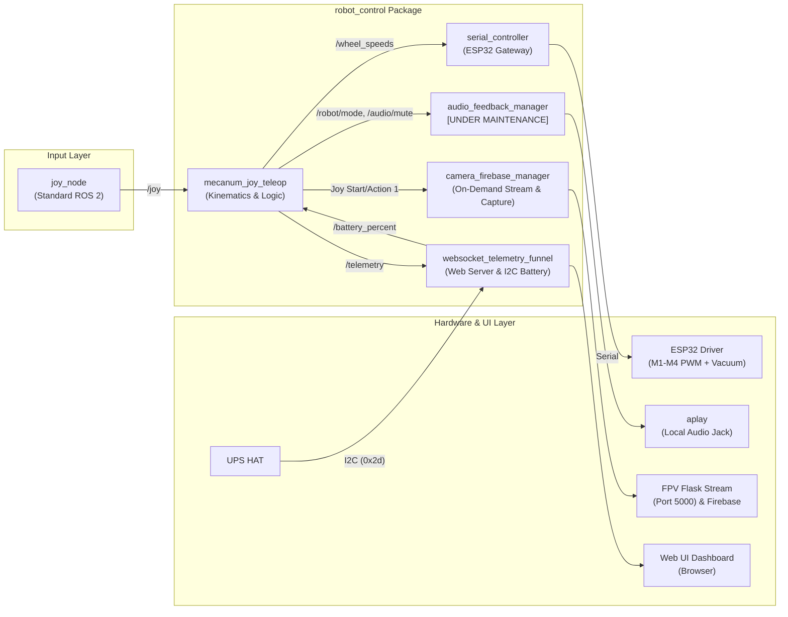
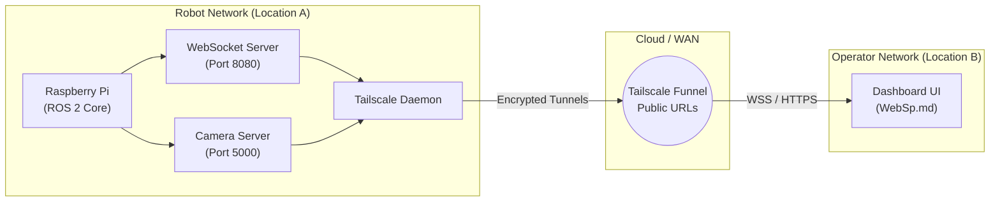

# 🤖 Teleoperated Waste Collection Robot (Escape Velocity V1.1.0)

[](https://docs.ros.org/)
[](#)
[](#)
[](#)
[](#)
[](LICENSE)

A modular, distributed robotics software stack for a 4-wheel Mecanum waste collection robot. Built on **ROS 2**, the current **Escape Velocity V1.1.0** iteration focuses on reliable teleoperation with real-time kinematics calculation, hardware safety isolation, low-latency telemetry streaming, advanced FPV Camera HUD, and remote dashboard monitoring via Tailscale mesh networking. The software architecture is explicitly designed to seamlessly integrate autonomous navigation in future updates.

---

## ✨ Key Features & System Highlights

### 📸 1. Vision, Cloud Storage & Offline Resilience
* **Automated Image Quota Management (FIFO Max 50 Photos):** Prevents storage exhaustion on the Raspberry Pi's SD card / NVMe drive. Local storage (`images/`) maintains a strict 50-photo limit (`max_images = 50`); whenever a new capture occurs, the oldest photos are automatically pruned using modification-time (`mtime`) FIFO sorting.
* **Offline-Resilient Capture Queue & Auto-Sync:** Photos captured during Wi-Fi or cellular dropouts are safely saved to local storage, and the payload is serialized into an offline queue (`pending_uploads.json`). A background daemon continuously polls connectivity every 10 seconds and automatically syncs all pending photos to Firebase Realtime Database (RTDB) once internet access is restored.
* **On-Demand MJPEG FPV Stream with Zero-CPU ISP Flipping:** Video streaming (Port 5000) defaults to OFF to preserve battery and wireless bandwidth, toggled instantly via the Gamepad **Start** button. Hardware 180° image rotation is offloaded directly to the Raspberry Pi VideoCore ISP.
* **Real-Time OpenCV HUD Overlay:** Enriches the FPV video stream with 0–60 cm parking guidelines for tight obstacle clearance, a sniper target crosshair, gimbal pan/tilt angles, and visual capture notifications.
* **Camera Hardware Resource Locking:** Dynamically manages camera sensor exclusivity, cleanly pausing the live video stream (`rpicam-vid`) when a high-resolution photo (`rpicam-still`) is requested, and resuming the stream immediately afterward.

### 🔋 2. Hardware Power Management & Fail-Safe Mechanics
* **Graceful Hardware Shutdown (`L1 + R1` Hold 5s):** Eliminates filesystem corruption by executing a safe OS shutdown (`sudo poweroff`) coupled with an I2C command to the Waveshare UPS HAT (`0x2d`) requesting a delayed 30-second 5V power cut-off.
* **Stationary Safety Interlock:** Prevents accidental shutdown during active driving. The shutdown countdown initiates **only** when the robot is completely stationary ($v_x = 0, v_y = 0, \omega_z = 0$). Any joystick deflection or wheel movement immediately cancels the timer.
* **Live I2C Battery Monitoring:** Continuous reading of battery percentage and voltage from the Waveshare UPS HAT via I2C (`smbus`), broadcasted to both the CLI dashboard and the remote web UI.

### 🤖 3. Boot-to-Run Autostart & Developer CLI Tools
* **Zero-Touch Autostart (Systemd):** The entire ROS 2 stack boots automatically on Raspberry Pi startup via `robot-core.service` with unbuffered real-time logging (`PYTHONUNBUFFERED=1`).
* **Developer Bash Aliases:** Includes high-productivity aliases (`robot-log`, `robot-status`, `robot-restart`, `robot-stop`, `robot-start`) for immediate live dashboard monitoring and service control from any terminal session.

### 📡 4. Field Networking & Remote Teleoperation
* **Headless Wi-Fi Captive Portal (`Mecanum_Setup`):** If no known Wi-Fi networks are found on boot, the robot creates a local AP Hotspot with a captive portal web UI (`setup_wifi.py`), allowing operators to reconfigure network credentials from their smartphone in the field without any external display or keyboard. The hotspot persists until the connection is fully verified.
* **Tailscale Mesh VPN & Funnel:** Enables cross-network teleoperation and telemetry dashboard access over public cellular / WAN networks without requiring router port-forwarding or public IP addresses.

### 🕹️ 5. Kinematics & Actuation Gateway
* **4-Wheel Mecanum Omnidirectional Drive:** Full holonomic locomotion (forward, strafe, rotate, and diagonal movement) with joystick deadzone filtering.
* **Decoupled ESP32 Gateway:** High-speed USB-Serial bridge isolating high-current motor PWM drivers and the vacuum relay from the Raspberry Pi host.

---

## 📌 1. System Architecture Overview

The system follows a distributed compute model, decoupling high-level compute and networking (Raspberry Pi) from real-time motor actuation (ESP32):

```text
+-----------------------------------------------------------------------------------+
|                                  USER / OPERATOR                                  |
|         [ Game Controller ]                     [ Web Dashboard (WebSp) ]         |
+------------------+------------------------------------------+---------------------+
                   |                                          ^
                   | (Bluetooth / USB)                        | (WebSocket / HTTPS)
                   V                                          |
+-------------------------------------------------------------+---------------------+
|                      RASPBERRY PI (ROS 2 Compute Brain)                           |
|                                                                                   |
|   [/joy] ----> [ mecanum_joy_teleop ] ----> [/wheel_speeds]                       |
|                       |                             |                             |
|                       | (kinematics.py)             v                             |
|                       |                     [ serial_controller ]                 |
|                       v                             |                             |
|             [ audio_feedback_manager ]              | (USB Serial / 115200 Baud)  |
|                       |                             v                             |
|                       | (aplay *.wav)     +-----------------------------------+   |
|                       v                   |             ESP32                 |   |
|                 [ Speaker ]               | (PWM Actuation & Vacuum Relay)    |   |
+-------------------------------------------+-----------------+-----------------+---+
                                                              |
                                                              V
                                              [ Motor Drivers & Actuators ]
```

---

## 🔄 2. ROS 2 Computational Graph & Data Flow



---

## 🌐 3. Networking & Remote Telemetry (Tailscale Integration)

One of the core challenges in this project was enabling remote teleoperation and dashboard monitoring across different physical locations and ISPs without modifying router port-forwarding rules. To solve this, the system integrates **Tailscale** for secure overlay networking:

* **Tailscale Mesh VPN:** Connects the Raspberry Pi and the operator's PC into the same secure private network, regardless of their physical locations.
* **Tailscale Funnel:** Used to securely expose both the WebSocket server (`websocket_telemetry_funnel.py`) and the Flask FPV Camera stream to the public internet without exposing the whole device.



---

## 🧠 4. Core Software Nodes & Features (Escape Velocity V1.1.0)

| Node / File | Primary Responsibility |
|---|---|
| **`mecanum_joy_teleop.py`** | Central command node. Ingests raw `/joy` inputs, performs deadzone filtering, executes 4-wheel **Inverse Kinematics**, manages PTZ Camera angles, displays a CLI dashboard, and publishes `/wheel_speeds`. Includes a **Graceful Hardware Shutdown** safety interlock (holding L1 + R1 for 5s) to safely power off the OS and schedule UPS HAT 5V cut-off. |
| **`serial_controller.py`** | High-speed, robust serial gateway to ESP32. Formats wheel commands into delimited ASCII packets (`<M1,M2,M3,M4,Vacuum,Yaw,Pitch>`) and controls the Vacuum Relay. |
| **`camera_firebase_manager.py`** | Native Python camera state manager. Provides an **On-Demand Local MJPEG FPV Stream** (Flask on Port 5000) using `rpicam-vid` with Hardware ISP Flipping and a **Modern OpenCV HUD Overlay** (Parking Guidelines, Crosshair, Telemetry). Handles high-res image capture, resource locking, Base64 compression, and **Firebase RTDB uploads**. Features **FIFO Storage Quota (Max 50 images)** and an **Offline Queue (`pending_uploads.json`)** with automatic background cloud sync. |
| **`websocket_telemetry_funnel.py`** | Real-time monitoring server **and hardware monitor**. Broadcasts system status, motor speeds, and reads **UPS HAT battery via I2C (`smbus`)**. It feeds data to the Web UI via WebSockets (Tailscale Funnel) and publishes `/battery_percent` back to the CLI dashboard. |
| **`audio_feedback_manager.py`** | **[CURRENTLY UNDER MAINTENANCE]** Headless status notifier. Uses `aplay` to play auditory cues for state transitions. |
| **`robot_core.launch.py`** | Automated orchestration. Brings up all core nodes, parameter configurations, and serial connections in a single command. |
| **`setup_wifi.py` & `startup_network.sh`** | **Headless Wi-Fi Captive Portal**. A systemd-enabled networking utility. On boot without internet, it spawns an AP Hotspot and a mobile-friendly Flask web UI to easily switch Wi-Fi networks in the field. |

---

## 💡 5. Engineering Decisions & Rationale

1. **Hardware ISP Image Flipping:**
   * In V1, we offload 180-degree image flipping to the `rpicam` Hardware Image Signal Processor. This completely removes CPU overhead for flipping frames while ensuring both the FPV Stream and the High-Res Photo Captures are perfectly oriented.
2. **OpenCV FPV Overlay (HUD):**
   * Real-time OpenCV drawings were added to provide an immersive operator experience. The FPV stream includes 0-60cm parking guidelines for tight navigation, a sniper-style crosshair, a black header bar indicating Pan/Tilt angles, and a flashing "PHOTO CAPTURED" notification.
3. **Decoupled ESP32 Serial Actuation:**
   * Linux on a Raspberry Pi is a Non-Real-Time OS. Offloading PWM signal generation and Relay triggering to the ESP32 ensures zero jitter on high-power motor drivers, maintaining smooth locomotion.
4. **On-Demand Camera Resource Management:**
   * FPV streaming drains bandwidth and battery. The camera system defaults to OFF. Using a gamepad toggle, it temporarily spawns an MJPEG Flask server via `rpicam-vid`. When a high-res photo is requested, the stream gracefully yields the hardware lock to `rpicam-still`, pushes to Firebase RTDB via Base64 string, and automatically resumes.
5. **Headless Wi-Fi Setup for Field Deployment (Dynamic Configuration):**
   * Field testing often involves unknown network environments where SSH or external monitors are unavailable. The `startup_network.sh` boot script uses `nmcli` to ping for internet access on boot. If it fails, it instantly broadcasts an AP Hotspot (Mecanum_Setup). Operators can connect via their smartphones to access the `setup_wifi.py` Flask portal, allowing them to enter new Wi-Fi credentials on the fly. This guarantees immediate, seamless network switching when migrating the robot between locations.
6. **Graceful Hardware Shutdown & Safety Interlock:**
   * Abruptly cutting DC power via a physical toggle switch risks corrupted file systems on the Raspberry Pi's SD card / NVMe storage. To prevent data corruption in the field, we introduced a gamepad-driven shutdown sequence: holding **L1 + R1 (Left & Right Bumpers) for 5 continuous seconds** while the robot is **completely stationary** (Safety Interlock: all wheel velocities and directional inputs $v_x, v_y, \omega_z$ must remain 0). Releasing the buttons or moving the robot immediately cancels the timer. Upon countdown completion, the node issues an I2C command to the Waveshare UPS HAT (`0x2d`) requesting a delayed 5V power cut-off in 30 seconds (`sudo i2cset -y 1 0x2d 0x01 0x55`), immediately followed by an OS-level graceful powerdown (`sudo poweroff`), allowing all file buffers to sync before power is removed.
7. **Local Storage FIFO Quota & Offline Resilient Cloud Sync:**
   * Field robotics frequently face intermittent Wi-Fi or cellular connections. Continuously capturing high-resolution photos without a storage boundary risks filling the Raspberry Pi's SD card / NVMe SSD, which can lead to filesystem corruption or OS failure. To solve this, `camera_firebase_manager` enforces a hard ceiling of 50 images (`self.max_images = 50`), automatically deleting the oldest image files via FIFO `os.path.getmtime` sorting. Additionally, if an upload fails due to network outage, the payload is persisted to `pending_uploads.json` and automatically flushed to Firebase RTDB by a background daemon as soon as internet connectivity returns.

---

## 🚀 6. Future Roadmap
* **Vision & Object Detection (OCR):** Integrating OpenCV into the camera manager pipeline to read meter numbers before Firebase upload (Semester 2).
* **Full Autonomous Mode:** Developing the logic to transition from human-controlled `/joy` input to AI-driven navigation based on detected waste.
* **Closed-Loop Speed Control:** Adding PID velocity control using quadrature encoders on the ESP32.

---

## 📁 7. Repository Structure

```text
ros2_ws/
├── scripts/
│   ├── setup_wifi.py              # Flask Wi-Fi Captive Portal UI
│   ├── startup_network.sh         # Network check & Hotspot boot script
│   ├── robot-portal.service       # Systemd unit for the captive portal
│   ├── start_ros2.sh              # ROS 2 Environment loader & stack launcher
│   ├── robot-core.service         # Systemd unit for the core robot stack
│   └── install_autostart.sh       # Automated autostart installer & aliases setup
├── src/
│   └── robot_control/
│       ├── launch/
│       │   └── robot_core.launch.py       # Starts all nodes (joy, teleop, audio, telemetry funnel)
│       ├── media/                         # Audio assets for system feedback (*.wav)
│       ├── UPS_HAT_E/                     # UPS Battery hardware scripts & utilities
│       ├── robot_control/                 # Python module source
│       │   ├── audio_feedback_manager.py  # [MAINTENANCE] Event-based audio playback node
│       │   ├── camera_firebase_manager.py # Flask FPV Stream & Firebase Integration
│       │   ├── mecanum_joy_teleop.py      # Core teleoperation & CLI Dashboard
│       │   ├── serial_controller.py       # USB-Serial ESP32 communication gateway
│       │   ├── websocket_telemetry_funnel.py # Tailscale Funnel WS & I2C Battery node
│       │   └── WebSp.md                   # Web dashboard UI source code
│       ├── package.xml                    # Package dependencies & metadata
│       └── setup.py                       # Console script entry points
```

---

## 🛠️ 8. Prerequisites & Dependencies

**Operating System:** Ubuntu 22.04 (Jammy) or newer, with **ROS 2** (Humble/Iron/Jazzy) installed.

### 1. System Dependencies (OS Level)
Install the required system packages. This includes NetworkManager (essential for the Wi-Fi Captive Portal), audio utilities, and I2C tools:
```bash
sudo apt update && sudo apt install network-manager alsa-utils python3-smbus i2c-tools
```

> [!TIP]
> **Passwordless Sudo for Graceful Shutdown:**
> To allow the teleoperation node to execute system poweroff and I2C commands without prompting for a sudo password, configure a rule via `sudo visudo` or by creating `/etc/sudoers.d/robot-power`:
> ```text
> spark ALL=(ALL) NOPASSWD: /sbin/poweroff, /usr/sbin/i2cset
> ```

### 2. Python Libraries
Install the necessary Python dependencies. Core libraries include `Flask` (for the FPV stream and Wi-Fi portal), `opencv-python-headless` (for the Camera HUD), and `pyserial`:
```bash
pip install -r requirements.txt
```

---

## 🚀 9. Quick Start & Launch

### 🤖 1. Automated Boot-to-Run (Recommended)
You can configure the robot to start automatically every time the Raspberry Pi powers on using the automated systemd installer:

```bash
# Run the autostart installer
bash ~/ros2_ws/scripts/install_autostart.sh

# Reload bash aliases in current session
source ~/.bashrc
```

#### 🛠️ Developer Management Shortcuts (Bash Aliases)
Once installed, managing the robot service and inspecting logs from any terminal is effortless:

| Command | Action | Description |
|---|---|---|
| **`robot-log`** | `journalctl -u robot-core.service -f -n 50` | Streams the live CLI Dashboard and ROS 2 console logs in real time. |
| **`robot-status`** | `systemctl status robot-core.service` | Displays current service health, uptime, and PID. |
| **`robot-stop`** | `sudo systemctl stop robot-core.service` | Temporarily halts the robot stack (e.g., for development/debugging). |
| **`robot-start`** | `sudo systemctl start robot-core.service` | Starts the robot stack background service. |
| **`robot-restart`** | `sudo systemctl restart robot-core.service` | Restarts the full robot stack cleanly. |

---

### 💻 2. Manual Launch (For Development)
If you prefer running the stack interactively in your terminal:

```bash
# Build workspace
cd ~/ros2_ws
colcon build --symlink-install --packages-select robot_control
source install/setup.bash

# Launch full stack (All nodes: Joy, Teleop, Audio, Telemetry Funnel)
ros2 launch robot_control robot_core.launch.py
```

---

### 🌐 3. Accessing the Dashboard & Camera

Once the system is running, you can monitor the robot remotely:

**1. Telemetry Web Dashboard (Hosted on Netlify)**
* Access the main control interface here: **[🔗 Refuse Robot - Netlify](https://refuserobot.netlify.app/)**
* **Local Network:** Dashboard WebSocket connects to `ws://<RASPBERRY_PI_IP>:8080`
* **Public Internet (Tailscale Funnel):** Dashboard connects securely via `wss://core.tailb47df1.ts.net:443` (Maps to 8080 locally).

**2. FPV Camera Live Stream**
* The stream defaults to **OFF** to save bandwidth and battery. 
* Press the **Start** button on your gamepad to toggle the stream **ON**.
* The stream features an advanced **OpenCV HUD Overlay** (Parking Guidelines, Crosshair, and Real-time Servo Angles).
* **Local Network:** `http://<RASPBERRY_PI_IP>:5000`
* **Public Internet (Tailscale Funnel):** `https://core.tailb47df1.ts.net:8443` (Maps to 5000 locally).

---

## 📝 10. Changelog & Version History

### [v1.1.0 - Escape Velocity] - 2026-10-12
#### ✨ Added
* **Boot-to-Run Systemd Autostart:** Automated startup on boot via `robot-core.service` and the one-step installer script `scripts/install_autostart.sh`.
* **Developer Bash Aliases:** High-productivity shell command shortcuts (`robot-log`, `robot-status`, `robot-restart`, `robot-stop`, `robot-start`) for live dashboard inspection and service management.
* **Offline Resilient Photo Queue & Cloud Auto-Sync:** Local caching and serialization queue (`pending_uploads.json`) with an asynchronous background worker that auto-syncs captured images to Firebase RTDB once network connectivity is restored.
* **Graceful Hardware Shutdown & Stationary Safety Interlock:** Gamepad-triggered safe shutdown (`L1 + R1` held for 5 seconds while strictly stationary), issuing an I2C delayed 5V power cut-off command to the Waveshare UPS HAT followed by OS poweroff.
* **Headless Wi-Fi Captive Portal:** Dynamic hotspot fallback (`Mecanum_Setup`) and a mobile-friendly Flask web portal (`setup_wifi.py`) for field network provisioning without peripherals.

#### 🔧 Improved & Optimized
* **Unified ROS 2 Launch Orchestration:** Merged `websocket_telemetry_funnel` directly into `robot_core.launch.py` to start the entire robot stack from a single launch command.
* **OpenCV HUD Real-Time Overlay:** Enhanced FPV stream with parking distance guidelines (0–60 cm), target crosshair, pan/tilt gimbal angle readouts, and visual capture notifications.
* **Zero-CPU Hardware ISP Flipping:** Offloaded 180° image rotation directly to the Raspberry Pi's Hardware Image Signal Processor (ISP).
* **Multi-Distro ROS 2 Compatibility:** Extended deployment compatibility to both Ubuntu 22.04 LTS (Humble) and Ubuntu 24.04 LTS (Jazzy).

